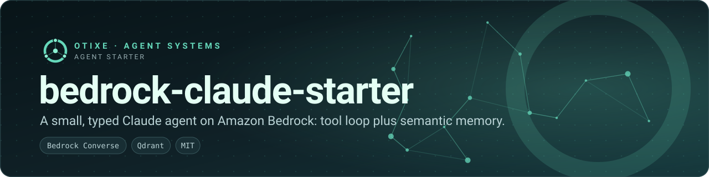
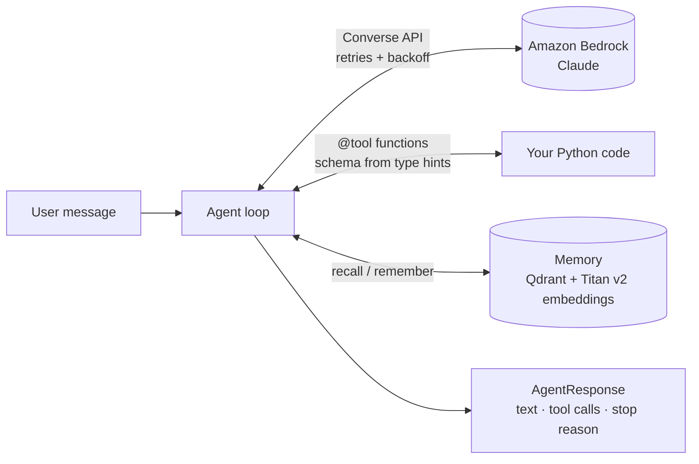
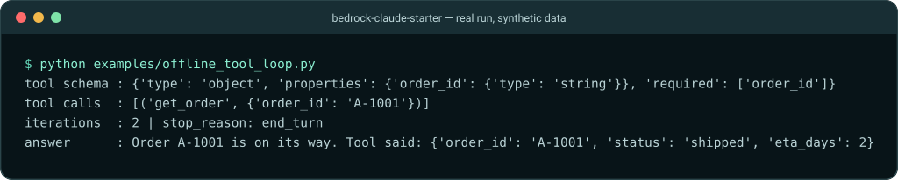

<p align="center">
  
</p>

<p align="center">
  <a href="https://github.com/otixe/bedrock-claude-starter/actions/workflows/ci.yml"></a>
  <a href="LICENSE"></a>
  
  
  
</p>

**A deliberately small starter for a Claude agent on Amazon Bedrock** — about a thousand lines you can read in an afternoon: a retrying Converse client, a decorator-based tool loop, optional semantic memory and typed messages.

## The problem

Most "Claude agent" examples are chat loops without the parts a real agent needs on day two: retries, tool plumbing that does not hand-write JSON schemas, a bounded loop, and memory that survives the conversation. Frameworks add those, along with a lot you did not ask for.

## The approach

Four pieces, each in its own small module, and nothing else:



1. **`BedrockClient`** — wraps `bedrock-runtime`'s Converse API; three attempts with exponential backoff; optional extended-thinking request field.
2. **`@tool`** — turns a typed Python function into a tool definition (JSON schema derived from the signature) and invokes it with the model's arguments.
3. **`Agent`** — runs the loop: send messages and tool specs, execute `toolUse` blocks, append results, repeat until a final answer or `max_iterations` (default 10).
4. **`Memory`** — stores exchanges in Qdrant (in-memory, on-disk or remote) with Titan Text Embeddings v2 (1024 dimensions) and recalls the top-k most similar into the system prompt.

## See it run

The demo swaps Bedrock for a scripted stand-in with the same response shape, so you can watch the loop call a tool and use its result — no AWS account needed.

<p align="center">
  
</p>

<sub>Terminal capture of examples/offline_tool_loop.py: the agent calls get_order and answers in two iterations.</sub>

## Quickstart

Python 3.10+. Not on PyPI yet:

```bash
pip install "git+https://github.com/otixe/bedrock-claude-starter.git"
```

Against real Bedrock you need AWS credentials with `bedrock:InvokeModel` access to a Claude model enabled in your account and region:

```bash
export AWS_PROFILE=my-bedrock-profile AWS_REGION=us-east-1
agent chat                       # interactive demo CLI
```

```python
from bedrock_claude_starter import Agent, tool

@tool(description="Look up an order by its ID.")
def get_order(order_id: str) -> dict:
    return {"order_id": order_id, "status": "shipped"}

agent = Agent(
    system_prompt="You are a support assistant. Use tools when needed.",
    tools=[get_order],
)
print(agent.run("Where is order A-1001?").text)
```

Add memory (needs Bedrock for embeddings; Qdrant runs in-process by default, or point it at a server):

```python
from bedrock_claude_starter import Agent, Memory

memory = Memory()                              # in-memory Qdrant
# Memory(qdrant_path="./qdrant") for disk, Memory(qdrant_url="http://localhost:6333") for a server
agent = Agent(memory=memory, memory_top_k=5)
```

## Design notes

- **Offline-testable.** `Agent` accepts any object with a `converse()` method through `bedrock_client=`, which is how the tests and the demo run without the cloud.
- **Bounded.** The loop stops at `max_iterations` and returns a `max_iterations` stop reason rather than spinning.
- **Typed.** Messages, tool definitions, memory entries and responses are Pydantic models.
- **No framework.** No LangChain, no LlamaIndex; read the source instead of the docs.

## Scope and limits

A starter, not a platform: one conversation per `Agent`, memory is "remember the exchange, recall by similarity", and the `thinking` flag passes a `reasoning_config` request field that only some models accept. Tool authorisation, multi-agent coordination and shared team memory are out of scope — that is what the Otixe platform is for.

## Part of the Otixe agent platform

Otixe builds persistent, accountable agent teams: **Pi** (runtime) → **Oficinas** (persistent teams) ↔ **Cerebro** (shared memory and work state) ↔ **Sinapsis** (web control surface), with **AMA** connecting the runtime to Cerebro.

A minimal reference for the agent loop (tools + memory) that the runtime layer generalises. The platform itself runs on Pi; this starter is independent of it.

[Otixe profile](https://github.com/otixe) · [Platform manual](https://github.com/otixe/plataforma) · [pi-oficinas](https://github.com/otixe/pi-oficinas)

## Validation

See [VALIDATION.md](VALIDATION.md) for the local Python matrix, reproducible checks and unproven integration boundaries. GitHub Actions has not been run by this delivery.

## License

MIT — see [LICENSE](LICENSE).
